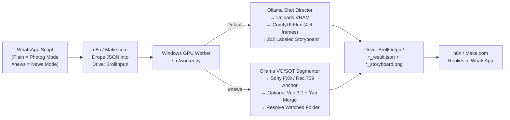

# Visual Hook B-Roll & News SOT Engine — Operator One-Sheet

> **One WhatsApp Inbox, Two Production Engines — 100% Local GPU Driven**
> Text any script to WhatsApp (via **n8n / Make.com → Google Drive `BrollInput`**) and your Windows GPU workstation automatically produces either a **Photog Visual Hook Storyboard** or a **Broadcast News VO/SOT Package** ready for **DaVinci Resolve**.

---

## 1. End-to-End Architecture



| Folder / Service | Path / Endpoint | Role |
| --- | --- | --- |
| **Inbound Drop** | `G:\My Drive\BrollInput` | Mirrors `YapInput` — n8n/Make drops script `.json` here |
| **Outbound Trigger** | `G:\My Drive\BrollOutput` | Mirrors `YapOutput` — n8n/Make watches for `*_result.json` |
| **Resolve Watched Dir** | `D:\ResolveWatch\NewsPackages\<pkg>\` | Pre-numbered Veo `.mp4` clips + Yap audio + Resolve markers |
| **Local LLM** | `http://127.0.0.1:11434` (Ollama) | Generates structured shot JSON (unloads VRAM right after) |
| **Local Image Gen** | `http://127.0.0.1:8188` (ComfyUI + Flux) | Renders visual reference panels (frees VRAM after batch) |

---

## 2. WhatsApp Inline Command Cheat Sheet

Add any hashtag anywhere in the script you text to WhatsApp:

| Tag | Mode | What It Does |
| --- | --- | --- |
| *(no tag)* | Photog Visual Hook | 4-panel (2×2) 16:9 Flux storyboard + WhatsApp shot list |
| `#vertical` or `#9:16` | Photog / News | Switches frames/video to vertical Reels/Shorts (`768×1024` / `9:16`) |
| `#horizontal` or `#16:9` | Photog / News | Landscape 16:9 commercial/broadcast framing (default) |
| `#shots=6` | Photog Visual Hook | Generates a 6-panel (3×2) storyboard instead of 4-panel (2×2) |
| `#noimages` | Photog Visual Hook | Skips ComfyUI Flux — instant text-only shot list back to WhatsApp |
| `#news` | News B-Roll & SOT | Runs VO/SOT segmenter → Sony FX9 Veo prompts → Resolve markers |

---

## 3. Proper Daily Operating Procedure

### Step A — Pre-Flight Check (Start of Day, 15 Seconds)
1. Ensure **Google Drive for Desktop** (or `rclone`), **Ollama**, and **ComfyUI** (`--listen 127.0.0.1 --port 8188`) are running.
2. Run a quick health check from `C:\Projects\visual-hook-broll`:
   ```powershell
   .\scripts\check_health.ps1
   ```
3. Confirm the watcher is active (auto-started via `.\scripts\install_scheduled_task.ps1`, or run manually with `.\scripts\start_worker.ps1`).

---

### Step B — Workflow 1: Commercial / Social Visual Hook Shoot (Photog Mode)
1. **Text your script** to your connected WhatsApp number (include `#vertical` for Reels or `#shots=6` for longer scripts).
2. You receive an instant acknowledgment; the worker runs Ollama → unloads VRAM → renders Flux panels → stitches the 2×2 labeled sheet.
3. **WhatsApp replies** with:
   - The **2×2 Labeled Storyboard Image** (`Top-Left`, `Top-Right`, `Bottom-Left`, `Bottom-Right` with lens/move badges & instructions).
   - The **Formatted Shot List Text** (0–3s Visual Hook, Curiosity-Loop arc, framing/lens, camera move, props/lighting, and on-set consistency lock).
4. **Forward directly to the photographer** — individual full-res panels and `shoot_card.md` are also archived inside `BrollOutput\<job_id>\`.

---

### Step C — Workflow 2: Broadcast News B-Roll & SOT Package (News Mode)

#### Option 1 — Quick Script Prep via WhatsApp (`#news`)
- Text `#news` followed by your raw `VO` / `SOT` / `STANDUP` blocks.
- By default (`auto_run_veo: false`), it runs in **safe review mode** (zero video API spend): segments shots, wraps every shot in the Sony FX9 / Rec.709 anchor, writes `veo_batch_prompts.md` + `resolve_markers.json`, and texts back the pre-numbered shot list + Resolve folder path.

#### Option 2 — Full Production Batch with Yap Audio Sync + Veo 3.1 (CLI)
1. **Always dry-run first** to review the objective descriptions and Sony FX9 prompts before spending Veo credits:
   ```powershell
   python -m src.news_engine examples\news_pkg_water_main.txt --prompts-only
   ```
2. **Run the live batch** with your Yap markers, Yap audio tracks, and an optional on-location reference still for color/lighting continuity:
   ```powershell
   python -m src.news_engine path\to\news_script.txt `
     --yap-markers "G:\My Drive\YapOutput\pkg_markers.json" `
     --yap-audio-dir "G:\My Drive\YapOutput\audio" `
     --ref-image "C:\Projects\refs\fx9_daylight_still.jpg" `
     --resolve-dir "D:\ResolveWatch\NewsPackages"
   ```
3. **Import into DaVinci Resolve:**
   - Open `D:\ResolveWatch\NewsPackages\<package_id>\`:
     - `00_Audio_Yap\` → Drag VO/SOT tracks onto Audio Track 1.
     - `01_Broll_Veo\` → Pre-numbered clips (`01_Suburban_Street.mp4`, `02_...mp4`) ready to drop in order.
     - Run `python resolve_markers.py resolve_markers.json` (or import `resolve_markers.csv`): **Green** = `VO` B-roll, **Cyan** = `SOT` cover shots.

---

## 4. Critical Guardrails (Do Not Skip)

> [!IMPORTANT]
> - **Single-GPU VRAM Handoff:** Keep `ollama.unload_after_generation: true` and `comfyui.free_vram_after_job: true` in `config.json`. This prevents Ollama and Flux from fighting over GPU memory.
> - **Veo 3.1 Endpoint & Credit Safety:** Use **Vertex AI GA** (`veo-3.1-fast-generate-001` or `veo-3.1-generate-001`) — Gemini API preview IDs were retired Oct 22, 2026. `--resume` is enabled by default so re-running an interrupted batch skips existing `.mp4` files and never double-bills.
> - **1080p / Reference Still Duration:** Veo 3.1 requires `durationSeconds: 8` when outputting `1080p`/`4k` or using `--ref-image`. The client enforces this automatically; trim to 3–5s news pacing inside Resolve using the staged markers.
> - **Atomic Trigger File:** n8n and Make.com must trigger **only** on `*_result.json` in `BrollOutput` — the worker writes that file *last* after the storyboard image is fully saved.

---

## 5. Fast Troubleshooting

| Symptom | Where to Look | Fix |
| --- | --- | --- |
| Script sits in `BrollInput` untouched | `worker.py` console / Task Scheduler | Run `.\scripts\check_health.ps1` and restart `.\scripts\start_worker.ps1` |
| Job moved to `BrollInput\_failed\` | `BrollOutput\<job>_error.json` | Read the exact error (usually Ollama model name or ComfyUI checkpoint filename mismatch in `config.json`) |
| ComfyUI CUDA Out-of-Memory | ComfyUI console | Confirm `unload_after_generation: true` in `config.json`, or switch `workflow_template` to `flux_schnell_api.json` |
| WhatsApp gets text but no image | n8n / Make.com Outbound flow | Confirm `BrollOutput` Drive Folder ID matches your Drive folder and `#noimages` wasn't in the script |
| Veo 3.1 returns HTTP 401/403/404 | `news_engine` console | Run `gcloud auth login` (or set `GOOGLE_ACCESS_TOKEN`), verify `VERTEX_PROJECT_ID`, and confirm model is `veo-3.1-fast-generate-001` |
